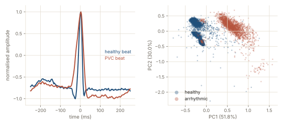

# Arrhythmia detection with Legendre polynomials, evaluated on patients never seen

Each heartbeat of an electrocardiogram is summarised by 13 Legendre coefficients, then classified as normal or abnormal. A school project reported 98.6 % accuracy with this pipeline. This repository reproduces that figure, measures what it owes to a single patient, then evaluates the same pipeline on patients never seen during training, with the standard inter-patient split of the MIT-BIH database.

## Context

STOCHA-FORGE is a signal-modelling environment in MATLAB built by a team of seven students at ENSEIRB-MATMECA (S8 project, January to May 2026, 180 hours, supervised by a professor). It was validated on two applications: the S&P 500 index and the detection of abnormal heartbeats. Yanis André led the biomedical strand: beat classification from Legendre coefficients, the Legendre and Chebyshev comparison under noise, and three modules of the MATLAB application.

The evaluation in this repository was redone afterwards, outside the team, in Python. The team's MATLAB code is not included. Only its results are used, through the files it produced and a rerun of the classification script.

## Results

| Question | Answer |
|---|---|
| Does the project's score reproduce? | Yes. The original MATLAB script rerun gives 98.6 % (KNN) and 98.5 % (SVM) again. The Python pipeline gives 99.2 % and 98.7 % on average over 20 random splits, and 98.6 % is among the lowest draws. |
| What does it measure? | Mostly patient 111. The project used four recordings (100, 101, 105 and 111). Patient 111 supplies 96.5 % of the abnormal beats and has no normal beat. The rule "abnormal if the beat comes from patient 111" scores 98.1 %. |
| On 22 patients never seen, with the project's definition (any anomaly)? | Balanced accuracy of 63.8 % (KNN) and 69.3 % (SVM), where 50 % is chance. |
| On 22 patients never seen, premature ventricular contractions against normal beats? | 87.5 % (KNN) to 93.4 % (SVM) of the contractions are found, about 9 in 10, for a balanced accuracy of 89.3 % and 90.3 %. But the contractions are only 7 % of the test beats: wrongly flagging 9 to 13 % of the normal beats is enough to outnumber the true detections (F1 of 56.4 % and 50.6 %). |
| Is N = 12 the right order? | Not an optimum. Other orders do better by 3 to 7 points in cross-validation, less than the spread between groups of patients (30 to 45 points). The 13 coefficients classify about as well as the 181 raw samples, while leaving about 40 % of reconstruction error. |



*Left, a healthy beat and a premature ventricular contraction (PVC), normalised. Right, a PCA projection of the beats of the project's four patients. The separation you see is largely patient 111, who supplies almost all the anomalies, against the other three.*

The full report, with every table, is [`results/rapport.md`](results/rapport.md) (in French). All the numbers are in [`results/etude.json`](results/etude.json).

## Method

1. **Beats.** MIT-BIH recordings at 360 Hz, MLII lead. Each annotated R peak gives a window of 181 samples (±250 ms), scaled to [−1, 1].
2. **Features.** Projection on the Legendre polynomials of degree 0 to 12 (trapezoidal rule), so 13 numbers per beat instead of 181.
3. **Classifiers.** KNN and RBF SVM from scikit-learn, after a standardisation learned on the training set.
4. **Reproduction (Q1, Q2).** The project's protocol on its four patients: class balancing, then a random 80/20 split of the beats, 20 seeds. Two details of the original script, a window shifted by one sample from the R peak and a K chosen on the test set, are reproduced here to recover its figures, then corrected for the rest of the study.
5. **Inter-patient evaluation (Q3).** Split of de Chazal et al. (2004): 22 recordings to learn from (DS1), 22 others to test on (DS2), no patient in common, recordings with a pacemaker excluded. The settings (K, C, gamma, class balancing) are chosen by 5-fold cross-validation grouped by patient on DS1 only, then DS2 is evaluated once. Two definitions are tested: (a) the project's, any anomaly against normal, and (b) the AAMI one, premature ventricular contraction against normal.
6. **Checks (Q4, Q5).** Balanced accuracy against the number of coefficients, and 13 coefficients against the 181 raw samples.

## Repository layout

```
src/ecg_legendre/         package: Legendre projection, beat windows, labels, protocols, metrics
scripts/etude.py          the whole study: writes results/etude.json, then results/rapport.md
scripts/rapport.py        writes results/rapport.md from results/etude.json (text in scripts/rapport_texte.md)
tests/                    unit tests of the building blocks
matlab/controle_matlab.m  optional check against the original MATLAB script
results/                  study results (JSON and report) and two CSV files from the original MATLAB scripts
docs/overview.svg         figure above
```

Code comments, identifiers and the report are in French.

## Run it

Requires [uv](https://docs.astral.sh/uv/).

```bash
uv sync
uv run pytest                       # building blocks, no data needed, about 1 s
uv run python scripts/etude.py      # whole study, 35 to 45 min on a laptop
uv run python scripts/rapport.py    # rewrites results/rapport.md from results/etude.json only
```

`scripts/etude.py` downloads the 48 MIT-BIH recordings (about 90 MB) into `data/mitdb/` the first time and checks them against the SHA-256 sums published by PhysioNet. For Q1 and Q2, the project read its four patients from its own `patient_*.mat` files. They are not distributed. When they are not in `data/projet/`, the script reads the same recordings from PhysioNet with the project's label table, which gives exactly the same beats, labels and coefficients (checked sample by sample on the project's files). The random seeds are fixed: with the versions of `uv.lock`, the study writes the same numbers again.

Optional MATLAB check: copy the project's `classification_ecg.m`, `Legendre.m` and `patient_*.mat` into `matlab_check/`, then run `matlab -batch "addpath('../matlab'), controle_matlab"` from that folder. `scripts/etude.py` then also compares the Python coefficients and accuracies with MATLAB.

The two CSV files in `results/` come from the original MATLAB scripts, rerun as they were: `projet_ecole_confusion.csv` holds the confusion matrices of the project (98.6 % and 98.5 %) and `legendre_tchebychev.csv` the reconstruction error of Legendre and Chebyshev polynomials on noisy test signals (80 draws per noise level).

## Limits

- **One test split.** 22 test patients and a single seed for the inter-patient part: gaps of a few points between settings prove nothing.
- **Large spread between patients.** The sensitivity to premature contractions ranges from 10 % to 100 % depending on the patient and the classifier, among the 9 test patients with 20 contractions or more.
- **Shape only.** The pipeline normalises each window and drops the rhythm. Anomalies that show in the timing rather than in the shape, such as atrial premature beats, are rarely found. The inter-patient literature adds RR intervals for this reason.
- **Settings at the edge of the grid.** Several chosen settings sit at the edge of the explored grid. The grid was not widened afterwards, because DS2 had already been looked at.
- **No comparison with published results**, which use other features and often the five AAMI classes.
- This is not a clinical device.

## Data and references

- MIT-BIH Arrhythmia Database, [PhysioNet](https://physionet.org/content/mitdb/1.0.0/), under the [Open Data Commons Attribution License v1.0](https://opendatacommons.org/licenses/by/1-0/). The recordings are downloaded by the script and not included here.
- Moody GB, Mark RG. The impact of the MIT-BIH Arrhythmia Database. IEEE Eng in Med and Biol 20(3):45-50 (2001).
- Goldberger A, et al. PhysioBank, PhysioToolkit, and PhysioNet. Circulation 101(23):e215-e220 (2000).
- de Chazal P, O'Dwyer M, Reilly RB. Automatic classification of heartbeats using ECG morphology and heartbeat interval features. IEEE Trans Biomed Eng 51(7):1196-1206 (2004). The DS1 and DS2 lists were checked against He et al., PLoS One 2018 (PMC6235298), and against the published code of Mondéjar-Guerra et al. (2019).

## Licence

The code is released under the [MIT licence](LICENSE). The MIT-BIH data keep their own licence.

Contact: contact@yanis-andre.fr
